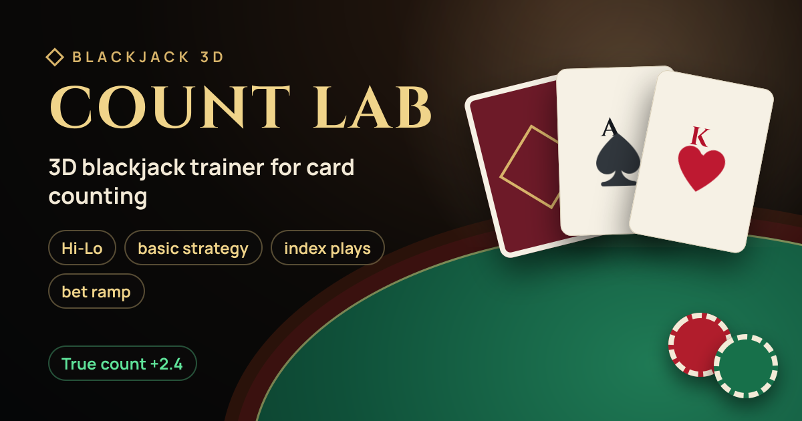
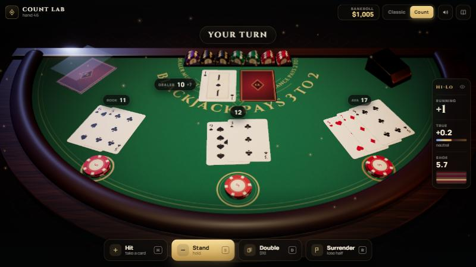
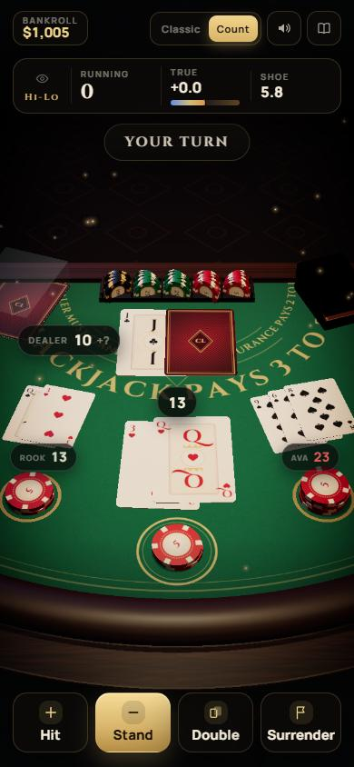
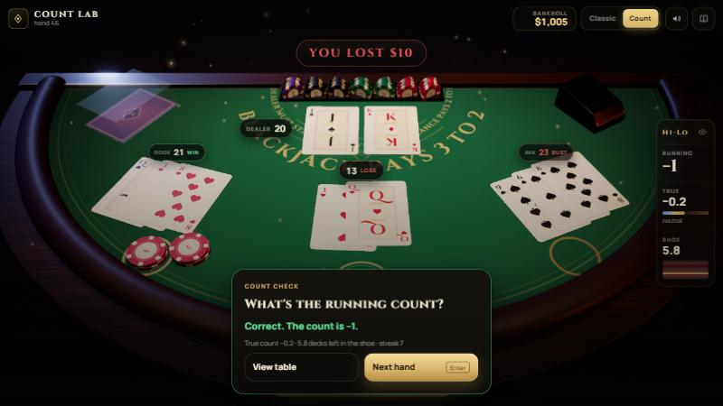
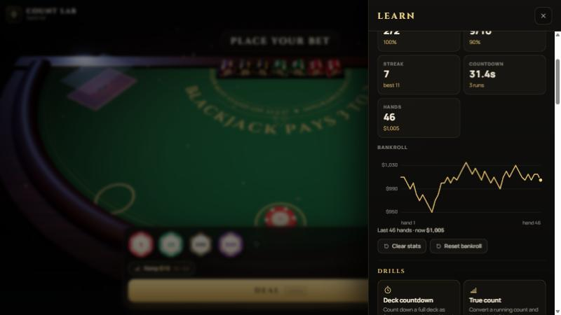

<div align="center">



# Count Lab · Blackjack 3D

**A 3D blackjack table in the browser for practicing Hi-Lo card counting, basic strategy, index plays and bet ramps.**

### [▶ Play now: countlab-blackjack.vercel.app](https://countlab-blackjack.vercel.app)


</div>

<p align="center">
  
</p>

<table>
  <tr>
    <td width="34%" valign="top"></td>
    <td width="66%" valign="top">
      
      <br /><br />
      
    </td>
  </tr>
</table>

Everything is procedural (no image or audio files): cards, chips, felt and wood are drawn on canvas, and the sounds are synthesized with WebAudio. It installs as an offline app.

## Features

- **Full table rules:** insurance / even money, late surrender, dealer peek, splits up to 4 hands, double after split.
- **Configurable:** 1, 2, 6 or 8 decks, H17/S17, DAS, surrender, penetration, betting unit.
- **AI players:** up to two seats (first and third base). Their cards count too.
- **Coach:** basic strategy for the chosen rules. In Count mode it adds the Illustrious 18, the Fab 4 surrenders and insurance at TC ≥ +3.
- **Bet ramp trainer:** suggested bet from the true count, scored every hand.
- **Drills:** end-of-hand count quiz, timed deck countdown, true-count conversion.
- **Progress:** hit rate for every skill and a bankroll history chart, stored locally in the browser.
- **Polish:** card flight and flip animations, chip payouts, count-reactive lighting, synthesized sound, haptics, graphics quality levels, keyboard shortcuts.

## Getting started

Requires Node.js 22.18 or newer.

```bash
npm install
npm run dev        # http://localhost:3000
```

| Script | What it does |
| --- | --- |
| `npm run dev` | Dev server with Turbopack |
| `npm run build` | Production build |
| `npm start` | Serve the production build |
| `npm test` | Simulates 840 hands across three rule sets and checks strategy and index plays |
| `npm run typecheck` | TypeScript check |

## Keyboard

| Key | Action |
| --- | --- |
| `H` `S` `D` `P` `R` | Hit, stand, double, split, surrender |
| `I` / `N` | Take / decline insurance |
| `Enter` | Deal / next hand |
| `Esc` | Close panels |

## Deploy

Deploys to Vercel with no configuration: import the repository, keep the defaults (framework **Next.js**) and deploy. The production URL is detected automatically for canonical links, Open Graph images, `robots.txt` and `sitemap.xml`. For a custom domain, set `NEXT_PUBLIC_SITE_URL` (see `.env.example`).

## Tech

Next.js 16 (App Router) · React 19 · three.js · React Three Fiber · drei · postprocessing · zustand · motion · TypeScript.

## Structure

- `src/lib/strategy.ts`: basic strategy by rules, index plays, bet ramp (pure functions).
- `src/lib/game.ts`: rules, shoe, counting, seats, insurance, settlement, history (no React/Three).
- `src/lib/store.ts`: bridge between `Game` and the UI (zustand), sounds, haptics and actions.
- `src/lib/site.ts`, `src/lib/og.tsx`: site URL/metadata and the generated social preview image.
- `src/three/`: the scene. Procedural table, animated cards, chips, lighting, post-processing.
  - `layout.ts`: positions and camera (landscape and portrait), AI seat spots.
  - `textures.ts`: cards, chips, felt and wood drawn on canvas.
- `src/ui/`: HUD, controls, Learn panel (stats, chart, rules), quiz, drills.
- `app/`: layout and metadata, Open Graph image, icons, manifest, robots, sitemap.
- `public/sw.js`: offline service worker (registered in production only).

## Disclaimer

A training tool. No real money is involved, and nothing here is gambling or financial advice.

## License

[MIT](LICENSE)
